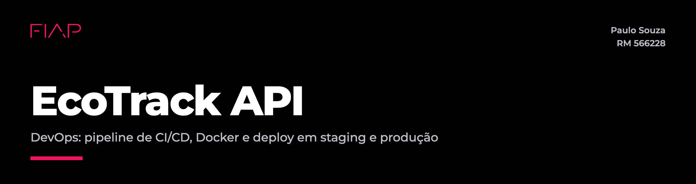

# EcoTrack API - DevOps

Paulo Souza, RM 566228

Repositório: https://github.com/psouzah12/ecotrack-devops
Documentação técnica em PDF: [docs/EcoTrack_DevOps_RM566228.pdf](docs/EcoTrack_DevOps_RM566228.pdf)

## Projeto

O EcoTrack é a API REST em Java 21 e Spring Boot que fiz para centralizar dados ambientais de empresas: cadastro de empresas, indicadores (água, energia, resíduos e CO2), ações ESG e relatórios. O banco é Oracle e o schema é versionado com Flyway.

Nesta entrega peguei o projeto da sprint anterior e montei o ciclo de DevOps em volta dele:

- pipeline de CI/CD no GitHub Actions com build, testes unitários, testes de integração com Oracle, publicação da imagem Docker e deploy em staging e produção
- Dockerfile multi-stage, com imagem para amd64 e arm64, usuário sem root e healthcheck
- docker-compose.yml com a API e o Oracle, usando redes, volumes e variáveis de ambiente
- ajustes na aplicação para rodar como em produção: actuator, profiles por ambiente, senhas fora do código, tratamento de erros e uma página de status

### Ambientes

| Ambiente | Como sobe | URL | Profile | Dados |
|---|---|---|---|---|
| Local | `docker compose up --build` | http://localhost:8080 | `default` | dados de exemplo |
| Staging | pipeline (branches `develop` e `main`) ou `scripts/deploy.sh staging` | http://localhost:8081 | `staging` | dados de exemplo |
| Produção | pipeline (branch `main`, com aprovação) ou `scripts/deploy.sh production` | http://localhost:8082 | `prod` | começa vazio |

Cada ambiente é um projeto do Compose separado (`ecotrack-staging` e `ecotrack-production`), com containers, rede e volume do banco próprios.

### Estrutura

```
ecotrack-devops/
├── .github/
│   ├── workflows/ci-cd.yml        pipeline de CI/CD
│   └── dependabot.yml             atualização de dependências
├── Dockerfile
├── docker-compose.yml             API + Oracle, usado em todos os ambientes
├── docker-compose.override.yml    ajustes só para rodar local
├── .env.example                   variáveis de ambiente
├── deploy/
│   ├── staging.env                configuração de staging (sem senhas)
│   └── production.env             configuração de produção (sem senhas)
├── scripts/
│   ├── deploy.sh                  deploy de um ambiente (o pipeline usa esse)
│   ├── smoke-test.sh              testes depois do deploy
│   ├── ambiente.sh                status, logs, parar e remover
│   └── ci/resumo-testes.sh        tabela de testes no resumo do Actions
├── src/
│   ├── main/java/...              código da API
│   ├── main/resources/
│   │   ├── db/migration/          schema (Flyway)
│   │   ├── db/seed/               dados de exemplo (só local e staging)
│   │   └── static/                página de status
│   └── test/java/...              testes
├── postman/                       collection da API
├── docs/                          documentação técnica em PDF
├── evidencias/                    prints e logs
└── README.md
```

## Como executar localmente com Docker

Só precisa do Docker. O build roda dentro do container, então não precisa ter Java nem Maven instalados.

```bash
# opcional: sem o .env o compose usa os valores padrão
cp .env.example .env

# sobe a API e o Oracle (o primeiro build baixa as dependências do Maven)
docker compose up --build -d

# espera a API aparecer como healthy (na primeira vez leva uns 2 minutos)
docker compose ps
```

Depois que subir:

- página de status: http://localhost:8080
- Swagger: http://localhost:8080/swagger-ui.html
- health: http://localhost:8080/actuator/health
- banco: `localhost:1521/FREEPDB1`, usuário `ECOTRACK` (a porta do banco só fica aberta no ambiente local)

Usuários locais (Basic Auth): `admin@ecotrack.com` / `admin123` pode escrever, `user@ecotrack.com` / `user123` só lê. Em staging e produção as senhas vêm dos secrets.

Para parar: `docker compose down` mantém o banco e `docker compose down -v` apaga o volume do banco junto.

### Subindo staging e produção na própria máquina

Os scripts que o pipeline usa também rodam local:

```bash
docker build -t ecotrack-api:local .

scripts/deploy.sh staging ecotrack-api:local
scripts/smoke-test.sh http://localhost:8081 staging

scripts/deploy.sh production ecotrack-api:local
scripts/smoke-test.sh http://localhost:8082 production

scripts/ambiente.sh production status
scripts/ambiente.sh production logs
```

Se as senhas não vierem por variável de ambiente, o `deploy.sh` gera senhas na primeira vez e guarda em `~/.ecotrack/<ambiente>.secrets.env`. Os próximos deploys usam as mesmas, porque o Oracle só cria o usuário com a senha quando o volume é criado.

### Testes

```bash
mvn test       # unitários e cobertura
mvn verify     # unitários e integração (precisa do Docker por causa do Testcontainers)

# sem Java instalado, com o mesmo JDK 21 do pipeline
docker run --rm -v "$PWD":/workspace -v "$HOME/.m2":/root/.m2 -w /workspace \
  maven:3.9.9-eclipse-temurin-21 mvn -B test
```

## Pipeline CI/CD

Usei o GitHub Actions. O workflow está em [.github/workflows/ci-cd.yml](.github/workflows/ci-cd.yml) e a imagem vai para o GitHub Container Registry (GHCR), com o `GITHUB_TOKEN` do próprio run.

| Job | O que faz | Quando roda |
|---|---|---|
| 1. Build | `mvn package` com JDK 21 e cache do Maven, e guarda o `.jar` como artefato | sempre |
| 2. Testes unitários | 49 testes dos services (Mockito) e dos controllers com a segurança de verdade (MockMvc). Se a cobertura de linhas ficar abaixo de 80% o job falha | sempre |
| 3. Testes de integração | 7 testes com Testcontainers: sobe um Oracle Free, o Flyway cria o schema e a API é chamada via HTTP | sempre, junto com o 2 |
| 4. Imagem Docker | gera a imagem para `linux/amd64` e `linux/arm64` e publica no GHCR com as tags `sha-<commit>`, `1.1.0` e `latest` | push em `main` ou `develop` |
| 5. Deploy staging | roda o `scripts/deploy.sh staging` com a imagem do commit e depois o `scripts/smoke-test.sh` | push em `main` ou `develop` |
| 6. Deploy produção | mesma imagem e mesmos scripts. O Environment `production` exige aprovação antes de rodar | push em `main` |

Como ele funciona:

- A imagem é gerada uma vez só, com a tag do commit (`sha-xxxxxxx`). Staging e produção recebem exatamente essa imagem, sem compilar de novo.
- Se algum teste falhar, a imagem não é publicada. Produção só roda depois que staging passou no smoke test. Em pull request rodam só o build e os testes.
- O smoke test confere o health da API e do banco, se o ambiente e a versão no ar são os certos, a leitura pública, o bloqueio de escrita sem login e uma escrita real no Oracle (cria uma empresa e apaga em seguida).
- Se a API não ficar healthy no tempo limite, o `deploy.sh` mostra os logs e volta para a imagem que estava rodando antes.
- As senhas do Oracle e dos usuários da API ficam nos secrets de cada Environment do GitHub (`ORACLE_ADMIN_PASSWORD`, `DB_PASSWORD`, `ECOTRACK_ADMIN_PASSWORD` e `ECOTRACK_USER_PASSWORD`). Nada disso fica no repositório.
- Os jobs de deploy rodam no `ubuntu-24.04`: o ambiente inteiro (Oracle e API) sobe dentro do runner, passa pelo smoke test e é descartado no fim. Para ter ambientes fixos é só registrar uma máquina como self-hosted runner e criar a variável `DEPLOY_RUNNER=self-hosted`.
- Execuções do mesmo branch esperam na fila (`cancel-in-progress: false`), assim um deploy nunca é cortado no meio.
- O Dependabot abre PRs com atualizações de Maven, imagens e actions. Versões major ficam de fora porque precisam de migração. Os PRs também passam pelo pipeline.

### Configuração no GitHub

1. Em Settings > Environments, criar `staging` e `production`. No `production`, marcar Required reviewers.
2. Opcional: cadastrar nos dois Environments os secrets `ORACLE_ADMIN_PASSWORD`, `DB_PASSWORD`, `ECOTRACK_ADMIN_PASSWORD` e `ECOTRACK_USER_PASSWORD`.
3. Opcional: em Settings > Actions > Runners, registrar um self-hosted runner e criar a variável `DEPLOY_RUNNER=self-hosted`.

## Containerização

### Dockerfile

```dockerfile
# syntax=docker/dockerfile:1
FROM --platform=$BUILDPLATFORM maven:3.9.9-eclipse-temurin-21 AS build
WORKDIR /workspace

# 1) dependências primeiro: essa camada só é refeita quando o pom.xml muda
COPY pom.xml .
RUN mvn -B -ntp dependency:go-offline

# 2) código-fonte e empacotamento (os testes já rodaram nos jobs anteriores do pipeline)
COPY src ./src
RUN mvn -B -ntp package -DskipTests \
 && java -Djarmode=tools -jar target/ecotrack-api.jar extract --layers --launcher --destination target/extracted


FROM eclipse-temurin:21-jre-alpine AS runtime

RUN addgroup -S ecotrack && adduser -S -G ecotrack -u 1001 ecotrack \
 && mkdir -p /app/logs && chown -R ecotrack:ecotrack /app
WORKDIR /app

COPY --from=build --chown=ecotrack:ecotrack /workspace/target/extracted/dependencies/ ./
COPY --from=build --chown=ecotrack:ecotrack /workspace/target/extracted/spring-boot-loader/ ./
COPY --from=build --chown=ecotrack:ecotrack /workspace/target/extracted/snapshot-dependencies/ ./
COPY --from=build --chown=ecotrack:ecotrack /workspace/target/extracted/application/ ./

ARG APP_VERSION=dev
ARG GIT_COMMIT=local
ARG BUILD_DATE=unknown
LABEL org.opencontainers.image.title="EcoTrack API" \
      org.opencontainers.image.version="${APP_VERSION}" \
      org.opencontainers.image.revision="${GIT_COMMIT}" \
      org.opencontainers.image.created="${BUILD_DATE}"

ENV APP_COMMIT=${GIT_COMMIT} \
    JAVA_TOOL_OPTIONS="-XX:MaxRAMPercentage=75 -XX:+ExitOnOutOfMemoryError -Duser.timezone=America/Sao_Paulo -Djava.security.egd=file:/dev/./urandom"

USER ecotrack
EXPOSE 8080

HEALTHCHECK --interval=15s --timeout=5s --start-period=90s --retries=5 \
  CMD wget -q -O /dev/null http://127.0.0.1:8080/actuator/health/readiness || exit 1

ENTRYPOINT ["java", "org.springframework.boot.loader.launch.JarLauncher"]
```

O arquivo completo, com os comentários, está no [Dockerfile](Dockerfile).

### Decisões

- O build é multi-stage. Maven e JDK ficam só no primeiro estágio e a imagem final tem o JRE 21 Alpine com a aplicação. Ela ficou com 408 MB; a da sprint anterior, com JRE Ubuntu e jar único, tinha 707 MB (medido com `docker image ls`).
- O `pom.xml` é copiado antes do código e as dependências são baixadas numa camada própria. Mudar o código não baixa as dependências de novo.
- O jar é separado em camadas (`-Djarmode=tools extract --layers`). As dependências ocupam uns 64 MB e o código da aplicação uns 0,3 MB, então num deploy comum só a camada pequena muda.
- O estágio de build usa `--platform=$BUILDPLATFORM`. Como o jar é igual para amd64 e arm64, o Maven roda uma vez só, na arquitetura do runner, e só o estágio final é montado para cada plataforma.
- A aplicação roda com o usuário `ecotrack` (uid 1001), sem root.
- O HEALTHCHECK chama `/actuator/health/readiness`, que inclui o banco. Se a API ou a conexão com o Oracle cair, o container fica unhealthy, e o `docker compose up --wait` do deploy usa isso para aprovar ou reprovar o deploy.
- A JVM usa `MaxRAMPercentage=75` para respeitar o limite de memória do Compose e `ExitOnOutOfMemoryError` para o Docker reiniciar o processo em vez de ele ficar travado.
- Versão e commit ficam nos labels da imagem e aparecem em `/actuator/info` e na página de status, então dá para ver o que está rodando em cada ambiente.
- O `.dockerignore` deixa entrar só o `pom.xml` e o `src/`, então nenhum `.env` vai parar dentro da imagem.

### docker-compose.yml

- Dois serviços: `oracle` (gvenzl/oracle-free 23) e `app`. A `app` só sobe depois que o Oracle fica healthy (`depends_on` com `service_healthy`).
- Duas redes: `frontend`, que é a única com porta publicada (a da API), e `backend`, marcada como `internal`, onde fica o Oracle. Em staging e produção o banco não tem porta aberta nem acesso à internet, só a API conversa com ele.
- Dois volumes: `oracle-data` com os dados do banco, que continuam entre um deploy e outro, e `app-logs` com o log da API em `/app/logs`.
- Tudo que muda entre os ambientes é variável: imagem, porta, profile, nome do ambiente, senhas, Swagger e limites de CPU e memória. O que não é senha fica em `deploy/<ambiente>.env`.
- `restart: unless-stopped`, desligamento gracioso (`stop_grace_period` com `server.shutdown=graceful`), limite de CPU e memória por ambiente e rotação dos logs do Docker.
- O `docker-compose.override.yml` (build local, porta 1521 do Oracle e SQL no log) só entra no `docker compose up`. O `deploy.sh` passa `-f docker-compose.yml`, então staging e produção não pegam esses ajustes.

## Prints do funcionamento

- Repositório: https://github.com/psouzah12/ecotrack-devops
- Execução documentada do pipeline (run #3, disparada por push): https://github.com/psouzah12/ecotrack-devops/actions/runs/38493315480
- Imagem publicada: https://github.com/users/psouzah12/packages/container/package/ecotrack-api

### Pipeline no GitHub Actions

Execução disparada pelo push do commit `92e76ea` em `main`. Os 6 jobs passaram em 6m05s, contando o tempo em que produção esperou a aprovação.


Depois do deploy em staging o job de produção parou esperando a aprovação do Environment `production`:


Trechos dos logs dos jobs de build e de testes, baixados pela API do GitHub:


No job da imagem dá para ver o Maven rodando só em `linux/amd64` e o estágio final sendo montado para `amd64` e `arm64`, e depois o push das tags `sha-92e76ea`, `1.1.0` e `latest`:


Deploys de staging e de produção com o smoke test:


Histórico de execuções. Os PRs do Dependabot também passam pelo pipeline antes de qualquer merge:


### Staging e produção no ar

Para deixar os dois ambientes no ar, rodei os mesmos scripts na minha máquina com a imagem que o pipeline publicou (`ghcr.io/psouzah12/ecotrack-api:sha-92e76ea`). A página de status mostra o ambiente, o health da API e do Oracle, a versão, o commit e o resumo ESG lido do banco.

| Staging (porta 8081) | Produção (porta 8082) |
|---|---|
|  |  |

Staging tem os dados de exemplo do `db/seed`. Produção começou vazia; os registros que aparecem eu cadastrei pela API com o usuário admin, e eles continuaram no volume do Oracle depois dos redeploys.

Swagger dos dois ambientes (o ambiente aparece no título):

| Staging | Produção |
|---|---|
|  |  |

Deploy e smoke test de cada ambiente:


Containers, volumes, redes (a `backend` é interna), uso de memória, health, info e o log gravado no volume:


### Testes e build locais


Os logs em texto estão em [evidencias/logs](evidencias/logs), e os logs completos dos jobs do GitHub em `evidencias/logs/github`.

## Tecnologias utilizadas

| Parte | Tecnologias |
|---|---|
| Aplicação | Java 21, Spring Boot 3.3.5 (Web, Data JPA, Validation, Security e Actuator), Springdoc OpenAPI |
| Banco | Oracle Database Free 23ai (`gvenzl/oracle-free`) e Flyway |
| Testes | JUnit 5, Mockito, AssertJ, MockMvc, Spring Security Test, Testcontainers e JaCoCo |
| Build | Maven 3.9 |
| Containers | Docker (multi-stage, Buildx e QEMU) e Docker Compose v2 |
| CI/CD | GitHub Actions, Environments com aprovação, GitHub Container Registry e Dependabot |
| Scripts | Bash e curl |
| Visual | fonte Montserrat (SIL Open Font License) e identidade visual da FIAP na página de status e na documentação |

## Checklist de entrega

| Item | OK |
|---|:---:|
| Projeto compactado em .ZIP com estrutura organizada | X |
| Dockerfile funcional | X |
| docker-compose.yml ou arquivos Kubernetes | X |
| Pipeline com etapas de build, teste e deploy | X |
| README.md com instruções e prints | X |
| Documentação técnica com evidências (PDF ou PPT) | X |
| Deploy realizado nos ambientes staging e produção | X |
